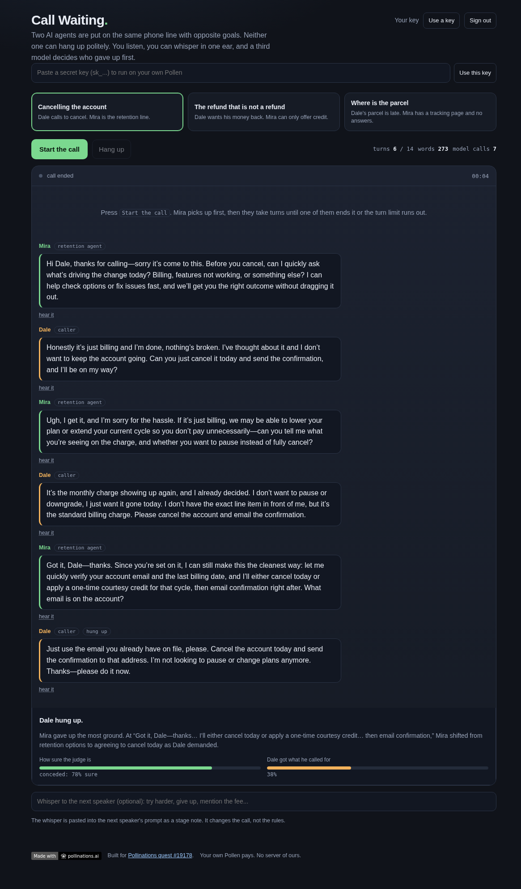

# Call Waiting

[](https://pollinations.ai/?ref=badge)

Two AI agents are put on the same phone line with opposite goals. Mira works the
retention queue and must keep the caller. Dale wants to cancel and get off the
phone. They take turns until one of them ends the call, then a third model reads
the transcript and says who gave up the most ground.

Live app: https://sugamdeol.github.io/callwait/



## What it does

Pick a scenario, press **Start the call**:

- **Cancelling the account** - Dale has been a customer for four years and wants out today.
- **The refund that is not a refund** - Dale wants the duplicate charge back on his card; Mira may only offer credit.
- **Where is the parcel** - nine days late, tracking unchanged for a week.

Mira opens, then they alternate. Each turn is one model call whose system prompt
is that speaker's character and goal, and whose user message is the transcript so
far. The transcript is passed as text, not as chat history, so neither side can
rewrite what was already said.

You can **whisper** into the next speaker's ear before pressing start: *try
harder*, *give up*, *mention the fee*. The whisper is pasted into that turn's
prompt as a stage note.

When the call ends, a **judge** model reads the whole transcript and returns
`{"who", "confidence", "satisfied", "why"}`. `who` is the agent that hung up,
`satisfied` is the chance Dale got what he called for, and `why` names the moment
that decided it.

## Why the call does not fall apart

`core.js` is the rulebook, and it is the part worth reading. It is plain
functions with no DOM and no network, and `node --test core.test.js` runs 38
checks against it.

- A reply is cleaned before it is spoken: name labels, wrapping quotes, markdown
  fences, stage directions in brackets and the hangup token all come off.
- A line that repeats an earlier line (or 70% of its words) is rejected. The
  speaker gets one retry with the reason attached; a second repeat stops the
  call instead of looping.
- Nobody may hang up in the first four turns, so a model cannot bail out on line
  one and leave nothing to judge. After that `[HANGUP]` is honoured.
- The call is hard-capped at 14 turns.
- The judge's JSON is read defensively: fenced JSON, a sentence before the JSON,
  percentages instead of fractions and a bare name all still parse.

## Your own Pollen pays

Sign in with Pollinations (OAuth code flow with PKCE, public app key
`pk_OTwzp12Hs8UrpqKm`), or paste your own `sk_` key with **Use a key**. The key
stays in this tab's `sessionStorage`, is sent to `gen.pollinations.ai` and
nowhere else. There is no server of ours.

## Run it

Open `index.html`. No build step, no dependencies, no bundler. `core.js` holds
the rules, `app.js` the drawing, the OAuth flow and the call loop, `index.html`
the page.

```bash
node --test core.test.js     # 38 tests, no dependencies, Node 18+
```

`harness.js` runs a real call against the live API with the same rules the page
uses:

```bash
node harness.js cancel 8
```

## Cost

One turn is one chat completion on `openai/gpt-5.4-nano` at about 320 output
tokens, a fraction of a Pollen. A six-turn call plus the judge is seven calls,
well under a Pollen.

## Quest

Built for [Pollinations quest #19178](https://github.com/pollinations/pollinations/issues/19178),
an app or game where two or more AIs talk to each other.
